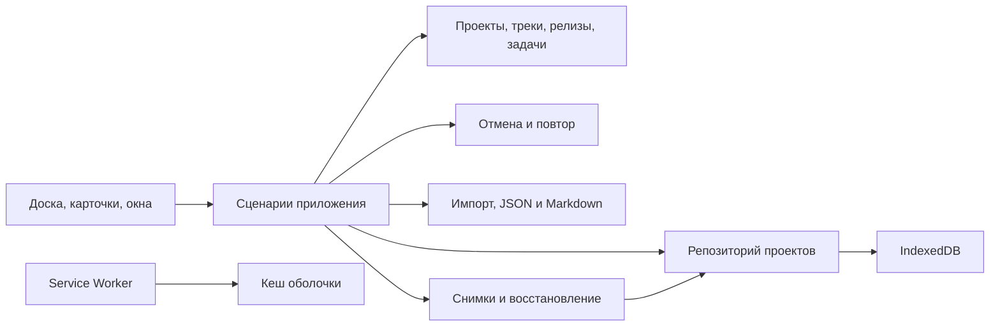

# Архитектура RoadMap

Сейчас `public/index.html` — автономный монолит для проверки UX. `scripts/build.mjs` копирует только `public/` в генерируемый `site/`; `projects/` и `archive/` не включаются. Ниже целевая структура приложения, ещё не реализованное разделение файлов.

| Модуль | Ответственность |
|---|---|
| `domain/` | Чистая модель, стабильные ID, инварианты, операции с проектами/карточками/релизами/треками |
| `application/` | Сценарии, переключение проекта, команды, координация сохранения |
| `history/` | Команды отмены/повтора, история отдельно для каждого проекта |
| `storage/` | IndexedDB, атомарная запись, версии схемы и миграции |
| `exchange/` | JSON-проверка, импорт, конфликты, Markdown, скачиваемые файлы |
| `backups/` | Снимки, ротация и восстановление через репозиторий |
| `ui/` | DOM, жесты, клавиатура, диалоги, поиск и отображение состояния |
| `preferences/` | Тема и локальные настройки интерфейса |
| `pwa/` | Установка, кеш оболочки, обновление и офлайн-запуск |

Карточка принадлежит одному проекту и одному треку. Назначенный релиз — один, либо backlog. В одной паре «трек × релиз» допускается несколько карточек с отдельным порядком. Выполненность не меняется автоматически из-за переноса.

Удаление релиза возвращает карточки в backlog. Удаление трека требует назначения другого трека. Импорт валидируется до изменения текущего проекта. Обновления и кеш PWA не управляют данными пользователя. Тексты пользователя выводятся как текст; HTML из описаний не исполняется.

Сохранение HTML остаётся переносимым снимком, а не основным будущим хранилищем. Персональные проекты не встраиваются в публикуемую оболочку. Бэкап и история отмены решают разные задачи: история — редактирование, бэкап — восстановление данных.
