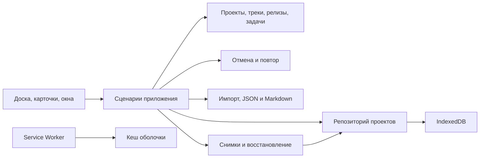

# Архитектура RoadMap

Сейчас `public/index.html` содержит модель, команды, вкладки проектов, интерфейс и собственные выпадающие меню. `public/pwa.js` управляет установкой и ожидающим обновлением; `public/sw.js` кеширует только оболочку. `scripts/build.mjs` копирует только `public/` в генерируемый `site/` и подставляет хеш исходников в Service Worker; `projects/` и `archive/` не включаются. Ниже целевая структура приложения, ещё не реализованное полное разделение файлов.

Текущее хранилище — атомарная версионированная запись `localStorage` с независимыми проектами и активной вкладкой. Перед записью сравнивается предыдущая версия записи: конфликт между вкладками блокирует перезапись. При ошибке команда откатывается. IndexedDB остаётся следующим этапом, а не уже реализованным модулем.

История и настройки вида хранятся в памяти отдельно для каждого проекта. При применении обновления весь сеанс переносится через `sessionStorage`; состояние проверяется перед восстановлением. Открытые формы и незавершённый импорт блокируют применение. Перезагружается только вкладка, запросившая обновление. Кеш имеет префикс полного scope приложения и ревизию; чистятся только старые кеши этого scope.

| Модуль | Ответственность |
|---|---|
| `domain/` | Чистая модель, стабильные ID, инварианты, операции с проектами/карточками/релизами/треками |
| `application/` | Сценарии, переключение проекта, команды, координация сохранения |
| `history/` | Команды отмены/повтора, история отдельно для каждого проекта |
| `storage/` | IndexedDB, атомарная запись, версии схемы и миграции |
| `exchange/` | JSON-проверка, импорт, конфликты, Markdown, скачиваемые файлы |
| `backups/` | Снимки, ротация и восстановление через репозиторий |
| `ui/` | DOM, жесты, клавиатура, диалоги, поиск и отображение состояния |
| `preferences/` | Тема и локальные настройки интерфейса |
| `pwa/` | Установка, кеш оболочки, обновление и офлайн-запуск |

Карточка принадлежит одному проекту и одному треку. Она занимает один релиз, непрерывный диапазон релизов или backlog. Диапазон отображается одной карточкой; пересекающиеся интервалы раскладываются на отдельные строки внутри трека. В одной паре «трек × релиз» допускается несколько карточек с отдельным порядком. Статус при переносе меняется только по явно заданному правилу целевой колонки.

Удаление релиза сокращает диапазоны, а карточки без оставшихся этапов возвращает в backlog. Удаление трека требует назначения другого трека. Импорт версий 1/2 валидируется до изменения текущего проекта; диапазоны и правила колонок используют версию 2. Обновления и кеш PWA не управляют данными пользователя. Тексты пользователя выводятся как текст; HTML из описаний не исполняется.

Сохранение HTML остаётся переносимым снимком, а не основным будущим хранилищем. Персональные проекты не встраиваются в публикуемую оболочку. Бэкап и история отмены решают разные задачи: история — редактирование, бэкап — восстановление данных.
