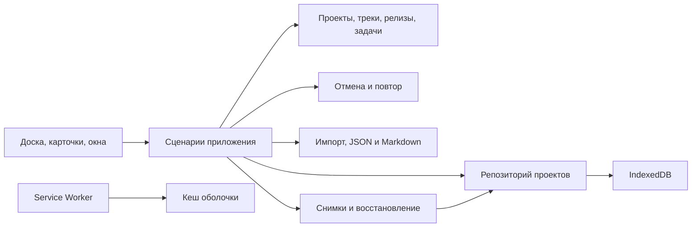

# Архитектура ROADMAPler

Сейчас `public/index.html` содержит модель доски, команды, вкладки проектов, интерфейс и собственные выпадающие меню. Чистая проверка переносимого проекта и список статусов выделены в `public/app/project-format.js`; браузер и автономный HTML используют одну реализацию. `public/pwa.js` управляет установкой и ожидающим обновлением; `public/sw.js` кеширует только оболочку. `scripts/build.mjs` копирует только `public/` в генерируемый `site/` и подставляет хеш исходников в Service Worker; `projects/` и `archive/` не включаются. Ниже целевая структура приложения, ещё не реализованное полное разделение файлов.

Текущее хранилище — атомарная версионированная запись `localStorage` с независимыми проектами и активной вкладкой. Перед записью сравнивается предыдущее значение записи: обнаруженное изменение другой вкладкой блокирует перезапись. Сравнение и последующий setItem не являются общей транзакцией двух вкладок; эта граница требует отдельной проверки и будущего изменения хранилища. При ошибке команда откатывается. IndexedDB остаётся следующим этапом, а не уже реализованным модулем.

История отмены хранится в памяти отдельно для каждого проекта; `public/app/history.js` ограничивает суммарные undo/redo 50 снимками и 2 МиБ строк UTF-16 на проект (без накладных расходов JS-движка). При переполнении удаляются самые старые снимки; слишком большой одиночный снимок очищает предшествующую цепочку, чтобы отмена не перескакивала через команду. Импорт и облачные замены используют тот же бюджет. Настройки вида, фильтр и поиск сохраняются отдельно для каждого проекта в localStorage между обычными запусками. При применении обновления сеанс переносится через `sessionStorage`; все истории в контрольной точке вместе ограничены 2 МиБ, приоритет у активного проекта, его история не дублируется в sessions. Не поместившиеся старые шаги других проектов остаются в текущей вкладке до обновления, но не переносятся. Если даже данные проектов с ограниченной историей превышают квоту, обновление блокируется без изменения данных и истории; состояние проверяется перед восстановлением. Открытые формы и незавершённый импорт блокируют применение. Перезагружается только вкладка, запросившая обновление. Кеш имеет префикс полного scope приложения и ревизию; чистятся только старые кеши этого scope.

| Модуль | Ответственность |
|---|---|
| `domain/` | Чистая модель, стабильные ID, инварианты, операции с проектами/карточками/релизами/треками |
| `application/` | Сценарии, переключение проекта, команды, координация сохранения |
| `history/` | Команды отмены/повтора, история отдельно для каждого проекта |
| `storage/` | IndexedDB, атомарная запись, версии схемы и миграции |
| `exchange/` | JSON-проверка, импорт, конфликты, Markdown, скачиваемые файлы |
| `backups/` | Снимки, ротация и восстановление через репозиторий |
| `ui/` | DOM, жесты, клавиатура, диалоги, поиск и отображение состояния |
| `preferences/` | Тема и локальные настройки интерфейса |
| `pwa/` | Установка, кеш оболочки, обновление и офлайн-запуск |

Карточка принадлежит одному проекту и одному треку. Она занимает один релиз, непрерывный диапазон релизов или backlog. Диапазон отображается одной карточкой; пересекающиеся интервалы раскладываются на отдельные строки внутри трека. В одной паре «трек × релиз» допускается несколько карточек с отдельным порядком. Статус при переносе меняется только по явно заданному правилу целевой колонки.

Удаление карточки подтверждается в её редакторе. Перед удалением трека или релиза пользователь выбирает удаление затронутых карточек либо их перенос: в существующие трек/релиз, backlog или новый трек в backlog. Для релиза учитываются все пересекающие его диапазоны; действие применяется ко всей карточке, о чём предупреждает диалог. Перенос сохраняет статусы и содержимое; при выборе конкретного релиза диапазон заменяется одной колонкой. Удаление последнего трека без переноса создаёт пустой новый трек. Вся операция сохраняется и отменяется одной командой. Импорт версий 1/2 валидируется до изменения текущего проекта; диапазоны и правила колонок используют версию 2. Обновления и кеш PWA не управляют данными пользователя. Тексты пользователя выводятся как текст; HTML из описаний не исполняется.

Сохранение HTML остаётся переносимым снимком, а не основным будущим хранилищем. Персональные проекты не встраиваются в публикуемую оболочку. Бэкап и история отмены решают разные задачи: история — редактирование, бэкап — восстановление данных.

## Новый релиз: адаптеры облака

`public/cloud/sync.js` содержит выбор действий по локальной/базовой/удалённой копии, адаптеры GitHub и Supabase и шифрование личного GitHub. `public/cloud/ui.js` содержит подключение, очередь обмена, режимы проектов, версии и разрешение конфликтов. Мост `window.roadmapApp` передаёт снимки и сохраняет через действующее атомарное хранилище, не выдавая облачному модулю изменяемые ссылки на модель. `public/cloud/config.js` содержит только публичные настройки владельца. SQL для RLS и записи с проверкой версии — `server/supabase.sql`, вне публикуемого сайта.

Метаданные синхронизации находятся в библиотеке, отдельно от переносимого проекта. Автономный HTML удаляет облачные модули и сохраняет локальную работоспособность. Полный контракт и границы локальной проверки: [CLOUD-SYNC](CLOUD-SYNC.md). Supabase владельца подключён; scoped API проверен на реальном проекте. Сценарии обычной авторизации и синхронизации двух настоящих устройств, а также реального личного GitHub остаются отдельной приёмкой, несмотря на пройденные локальные протокольные проверки.

## Настройки представления и точечные интеграции

Вид доски хранится отдельно от пользовательского проекта, в локальном хранилище с областью пути приложения и ID проекта. Сохраняются скрытые треки/релизы, backlog, фильтр, поиск и оба переключателя выполненных элементов. Web и PWA одного origin/scope используют то же хранилище; другое устройство имеет свои настройки. Эти параметры не попадают в JSON/HTML-данные проекта и облачную историю; история отмены остаётся в памяти сеанса и контрольной точке явного обновления PWA.

`server/integration-api.sql` добавляет компактные RPC карточек, структуры и изменений после ревизии поверх прежних токенов. Все записи проходят через общий `write_project` с повторной проверкой ревизии под блокировкой и общей валидацией. Дельта строится по сохранённым снимкам обычных UI/API-записей; потерянная база даёт явный `reset_required`, а не неполный результат. Протокол и порядок применения: [INTEGRATIONS-COMPACT](INTEGRATIONS-COMPACT.md).

Порядок вкладок задаётся позицией в настройках проекта и при создании. Он хранится в порядке проектов локальной библиотеки, не в переносимом JSON одного проекта. Команда перестановки сохраняет данные проекта и порядок атомарно; история команды содержит отдельный снимок порядка и поддерживает старые записи истории. Отмена переставляет только существующие проекты, оставляет добавленные позже и не воскрешает удалённые. Контрольная точка PWA валидирует обе формы истории.

## Контракт формата и импорт

Браузерный `RoadmapProjectFormat.validateProject` проверяет типы и уникальность ID/title, зарезервированные релизы, ссылки, статусы и границы диапазона до изменения библиотеки. Неизвестные поля сохраняются. JavaScript и PostgreSQL проверяются одним набором фикстур `tests/fixtures/project-format.json`. Модуль не зависит от DOM и хранилища; экспорт HTML встраивает его собственный portable installer, а PWA кеширует файл вместе с оболочкой.

При импорте поверх существующего проекта заменяется только переносимая `data`, сохраняются `cloud` и дополнительные метаданные записи библиотеки. Предыдущая `cloud.base` и ревизия не подменяются импортом: изменение остаётся обычной локальной правкой с последующим CAS/конфликтом. Создание отдельной импортированной копии не наследует облачную привязку. Локальные регрессии: [TESTING](TESTING.md).
